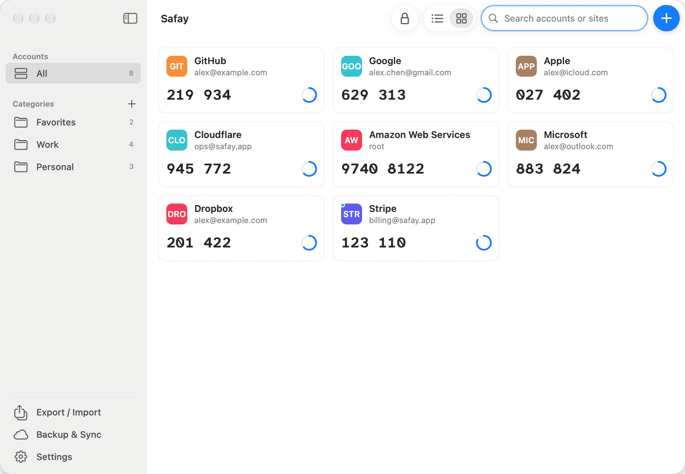
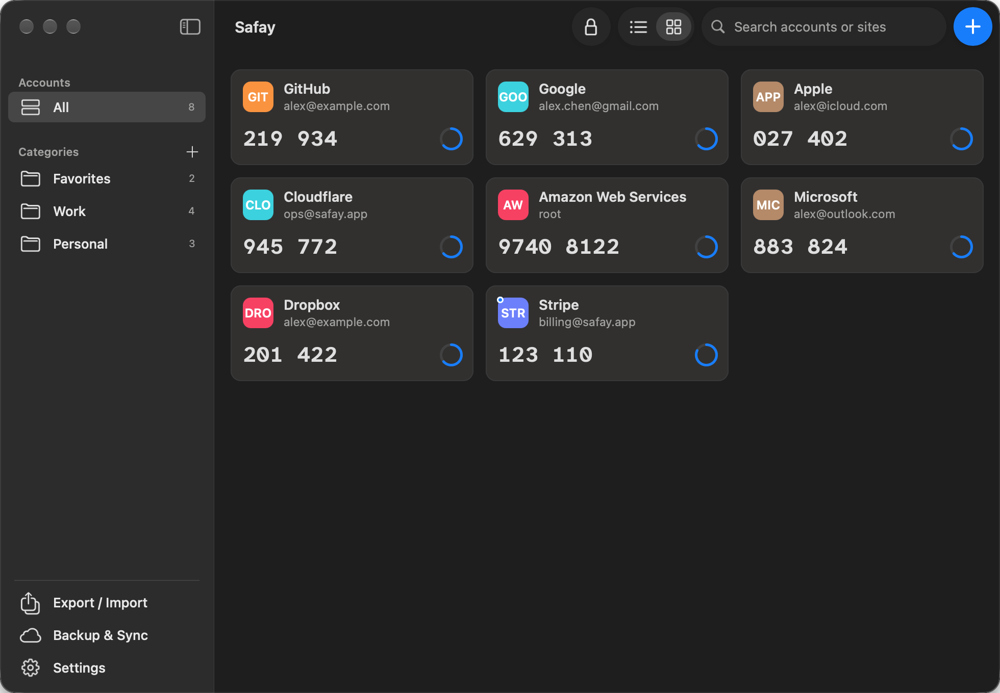
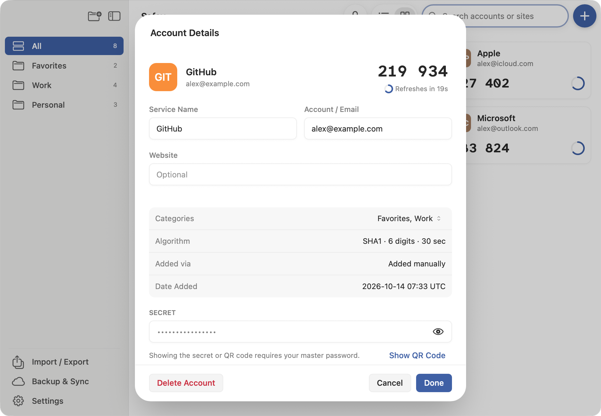
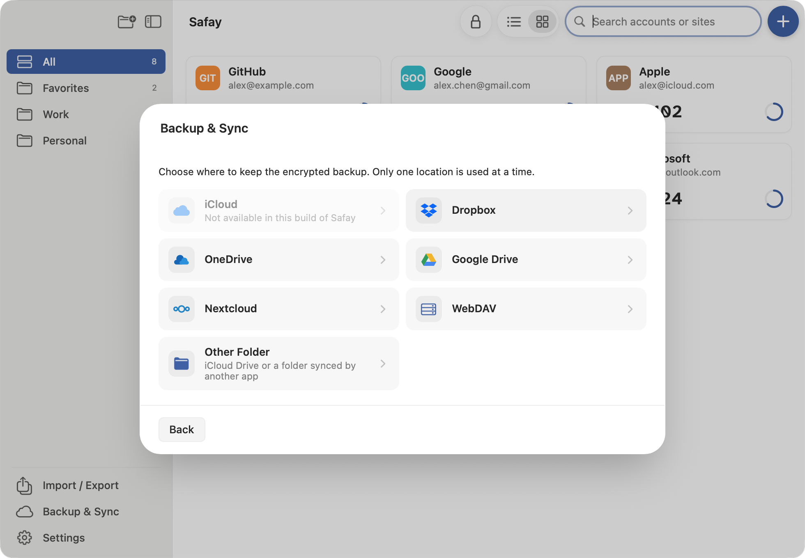
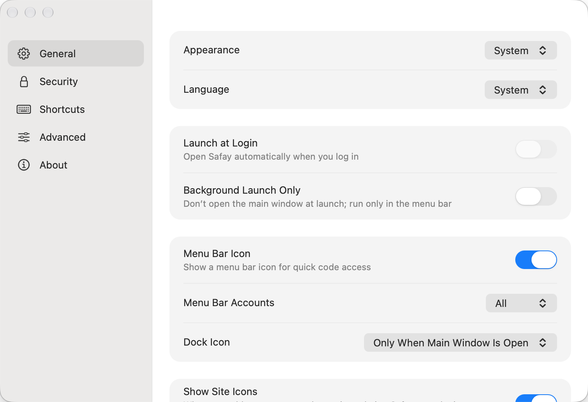
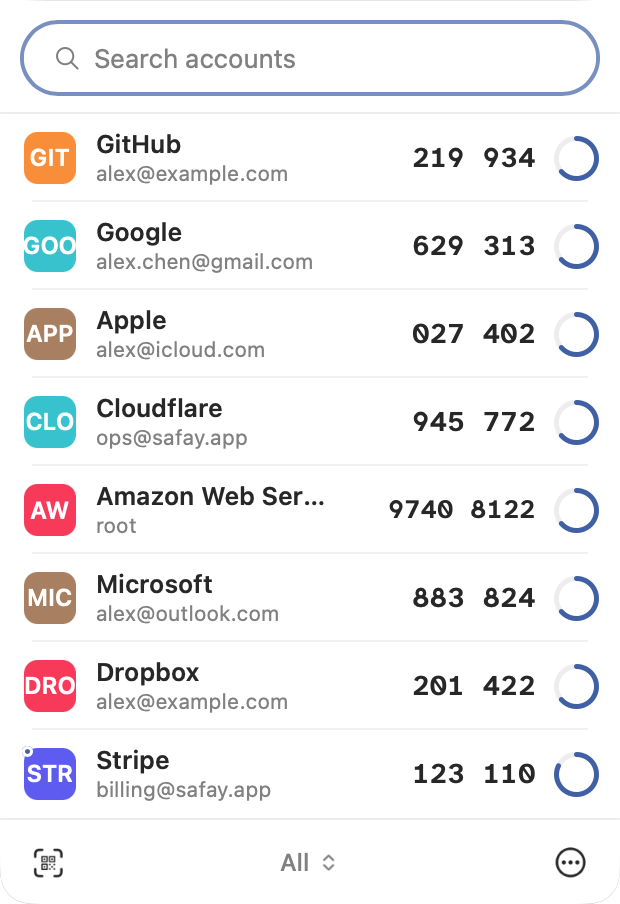

# Safay

Safay is a two-factor authenticator for the desktop. It keeps your TOTP accounts in a local, end-to-end encrypted vault,
shows the current codes, and backs the vault up to a location you choose — without a Safay account or server.

The interface is written in Rust with [NSH](https://github.com/longbridge/nsh), a native UI framework, so one code base
renders native windows on macOS, Windows and Linux.



## Download

| Platform | Get it |
|---|---|
| **macOS** 14 or later, Apple silicon | `Safay-<version>.dmg` from the [latest release](https://github.com/gicek/safay/releases/latest): open it and drag Safay to Applications. Signed and notarized. |
| **Windows**, **Linux** | Not published yet. They build from the same code but have not been run end to end; see [Platforms](docs/PLATFORMS.md) and [Getting started](#getting-started). |

On its second launch Safay asks whether to check for updates once a day; each new version then opens in its update
window, or downloads and installs on its own if you choose. The other files on each release — the zip, the `.tar.gz` update archive and `latest.json` — are for the
updater and for scripts; you don't need them to install. Each release's notes are in [CHANGELOG.md](CHANGELOG.md).

## Features

- **Codes**: TOTP with SHA-1/256/512, 6 or 8 digits, 30 or 60 seconds; copy with one click; cards or a list.
- **Adding accounts**: enter a key, paste `otpauth://` links (including Google Authenticator migration codes), drop QR
  images, select a QR code on screen, or scan one with the camera.
- **Organizing**: search, categories with multiple membership, drag to reorder, site icons fetched from each account's
  own website (optional).
- **Vault**: Argon2id + AES-256-GCM, master password with strength rules, auto-lock, lock on sleep and screen lock,
  delays after failed attempts, Touch ID backed by the Secure Enclave, a last-good copy to roll back to.
- **Backup and sync**: a folder, iCloud, WebDAV, Nextcloud, Dropbox, OneDrive or Google Drive. Only the encrypted vault
  leaves the device; conflicts are compared and resolved, never silently overwritten.
- **Import and export**: encrypted Safay exports; backups from Aegis, 2FAS, Ente Auth, Proton Authenticator, Authenticator
  (browser extension), and Bitwarden; CSV exports from Apple Passwords and other password managers; and text files with
  one `otpauth://` link per line.
- **Desktop integration (macOS)**: menu bar panel, global shortcuts, launch at login, a settings window, and launchers —
  Alfred, Raycast and Tinycast — that search accounts and ask Safay to copy a code.
- English, Simplified Chinese and Traditional Chinese; light and dark appearance.

Every sensitive action — showing a secret or QR code, exporting, copying from a launcher — asks for Touch ID or the
master password again. The design is described in [SECURITY.md](SECURITY.md).

## Getting started

Requirements: Rust 1.100.0 (`rust-toolchain.toml`), Python 3, and the platform's native toolchain (Xcode Command Line
Tools on macOS). Linux also needs GTK 4, WebKitGTK 6 and GStreamer development packages — the exact list is in
[Development](docs/DEVELOPMENT.md#toolchain).

```sh
make preview    # run with an in-memory vault that is discarded on quit
make run        # run with a real local vault (development data directory)
make ci         # formatting, lints and every test, as CI runs them on macOS
make package    # build a development app bundle (macOS)
make            # list all targets
```

Targets that need the NSH command-line tool build it from the commit pinned in `Cargo.lock` on first use.
[Development](docs/DEVELOPMENT.md) covers the toolchain, tests, packaging and releases.

## Screenshots

| | |
|---|---|
|  |  |
|  |  |

The menu bar panel:



All screenshots use synthetic accounts.

## Documentation

| | |
|---|---|
| [Architecture](docs/ARCHITECTURE.md) | Crates, the session model, data on disk, backup and sync, networking, launchers |
| [Security](SECURITY.md) | Threat model, cryptography, every network request, reporting a vulnerability |
| [Platforms](docs/PLATFORMS.md) | What works on macOS, Windows and Linux, and known issues |
| [Development](docs/DEVELOPMENT.md) | Building, testing, packaging, signing and releasing |
| [Design](docs/DESIGN.md) | Interface conventions and platform styles |
| [Launcher integrations](integrations/README.md) | Alfred, Raycast and Tinycast |
| [Contributing](CONTRIBUTING.md) | How to propose changes |


## License

Safay is released under the [MIT License](LICENSE). Bundled fonts, brand marks and dependencies are listed in
[THIRD_PARTY_NOTICES.md](THIRD_PARTY_NOTICES.md).
